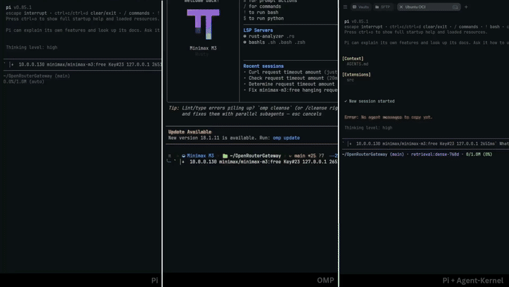
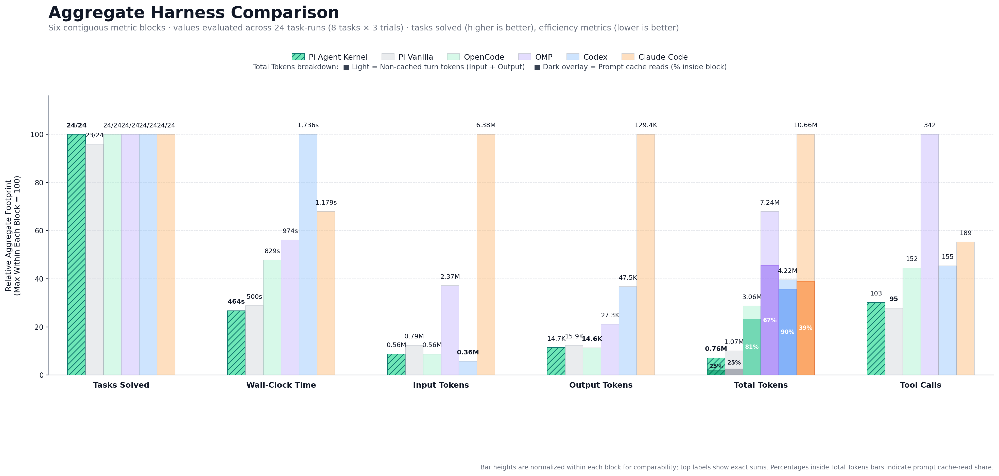

# pi-agent-kernel



Coding agents waste context when they read entire files to inspect one function, dump thousands of lines of terminal output, or rewrite whole files for small edits. `pi-agent-kernel` is an extension for Pi that keeps sessions compact by clamping command outputs, capping file reads, and verifying edits before saving.

---

## Benchmarks

Evaluating 6 coding agent harnesses across 8 bug fixes (`hono`, `ky`, `zod`, `ufo`, `picomatch`, `fastify`, `uuid`, `p-limit`) with `cx/gpt-6-luna-high` (OmniRoute, concurrency 4, 360s timeout). Pi harnesses report mean values across 3 repeated runs (N=3):



---

## Quick start

### 1. Install

Install the extension through Pi's package manager:

```bash
# Global install
pi install npm:@floydous/pi-agent-kernel

# Local install for the current workspace only
pi install -l npm:@floydous/pi-agent-kernel
```

Restart Pi or start a new session.

---

### 2. Settings and configuration (`/agent-kernel`)

Run `/agent-kernel` to open the unified 3-tab interactive controller:

```text
/agent-kernel
```

The modal lets you manage:
- **`[1] Kernel Settings`**: Toggle the Epistemic Guard, reading anchor modes, output clamping ceilings (`40`, `100`, `200` lines), dot normalization, and prompt guidance.
- **`[2] Retrieval Engine`**: Configure the code search profile (`auto`, `lean`, `full`, `off`) and trigger full workspace re-indexing.
- **`[3] File Index Scope`**: Browse the repository tree, toggle folder and file exclusions, and inspect live code chunk counts.

You can also manage settings and retrieval directly from the command line:
```text
/agent-kernel status             # Print current configuration and file locations
/agent-kernel engine             # Open directly to Retrieval Engine controls
/agent-kernel scope              # Open directly to File Index Scope tree
/agent-kernel reindex            # Force full workspace re-indexing
/agent-kernel set <key> <val>    # Update a setting (e.g. set profile full, set max_lines 200)
/agent-kernel reset              # Reset global configuration to defaults
```

---

### 3. Retrieval engine profiles

`pi-agent-kernel` includes an in-memory retrieval engine for code search:

- `lean` (default): AST-indexed BM25 keyword search with sub-millisecond retrieval and zero extra memory footprint.
- `full`: Lexical BM25 search fused with 768-dimension code embeddings from `Alibaba-NLP/gte-modernbert-base` (~147 MB, downloaded on first use) via Reciprocal Rank Fusion. `hybrid` is accepted as an alias.
- `auto`: Automatically selects `lean` on machines with fewer than 4 CPU cores and `full` on machines with 4 or more cores.
- `off`: Disables local indexing completely.

---

### 4. Disable Pi documentation for external projects

Pi injects reference documentation for building Pi extensions into every session. When working on ordinary codebases, you can hide those docs to save prompt space:

```text
/pi-docs off
```

Use `/pi-docs on` when returning to work on Pi extensions.

---

## Tool reference

| Tool | Description |
|---|---|
| `read` | Reads file contents with 50 KB / 2,000-line caps and bounded line-windowing (`offset`/`limit`). |
| `edit` | Applies search-and-replace patches with automatic delimiter healing and optional `line_hint` line coordinates. |
| `write` | Creates new files or replaces complete files. |
| `bash` | Runs shell commands with clamped output and spillover logging. |
| `code_search` | Combines AST BM25 keyword matching and semantic embeddings with symbol breadcrumbs. |

---

## License

ISC
