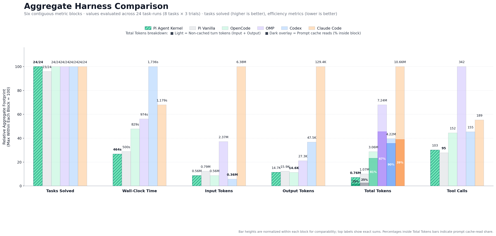

# pi-agent-kernel


Coding agents waste context when they read entire files to inspect one function, dump thousands of lines of terminal output, or rewrite whole files for small edits. `pi-agent-kernel` is an extension for Pi that keeps sessions compact by clamping command outputs, capping file reads, and verifying edits before saving.

---

## Benchmarks

Evaluating 6 coding agent harnesses across 8 bug fixes (`hono`, `ky`, `zod`, `ufo`, `picomatch`, `fastify`, `uuid`, `p-limit`) with `cx/gpt-6-luna-high` (OmniRoute, concurrency 4, 360s timeout). Pi harnesses report mean values across 3 repeated runs (N=3):



---

## Quick start

### 1. Install

Install the extension through Pi's package manager:

```bash
# Global install
pi install npm:@floydous/pi-agent-kernel

# Local install for the current workspace only
pi install -l npm:@floydous/pi-agent-kernel
```

Restart Pi or start a new session.

---

### 2. Configure the retrieval engine (`/engine`)

`pi-agent-kernel` includes an in-memory retrieval engine for keyword and vector search:

```text
/engine status
```

- `auto`: Selects `lean` on remote servers, `hybrid` on laptops, or `full` on desktops based on available hardware.
- `lean` (default): AST-indexed BM25 keyword search with no extra memory footprint.
- `hybrid`: BM25 search combined with 256-dimension Matryoshka embeddings.
- `full`: 768-dimension dense semantic search.
- `off`: Disables local indexing completely.

---

### 3. Settings and configuration (`/agent-kernel`)

Run `/agent-kernel` to open the settings interface:

```text
/agent-kernel
```

You can also manage settings from the command line:
```text
/agent-kernel status             # Print current configuration and file locations
/agent-kernel set <key> <val>    # Update a setting globally
/agent-kernel reset              # Reset global configuration to defaults
```

---

### 4. Disable Pi documentation for external projects

Pi injects reference documentation for building Pi extensions into every session. When working on ordinary codebases, you can hide those docs to save prompt space:

```text
/pi-docs off
```

Use `/pi-docs on` when returning to work on Pi extensions.

---

## Tool reference

| Tool | Description |
|---|---|
| `read` | Reads file contents with 50 KB / 2,000-line caps and bounded line-windowing (`offset`/`limit`). |
| `edit` | Applies search-and-replace patches with automatic delimiter healing and optional `line_hint` line coordinates. |
| `write` | Creates new files or replaces complete files. |
| `bash` | Runs shell commands with clamped output and spillover logging. |
| `code_search` | Combines AST BM25 keyword matching and semantic embeddings with symbol breadcrumbs. |

---

## License

ISC
